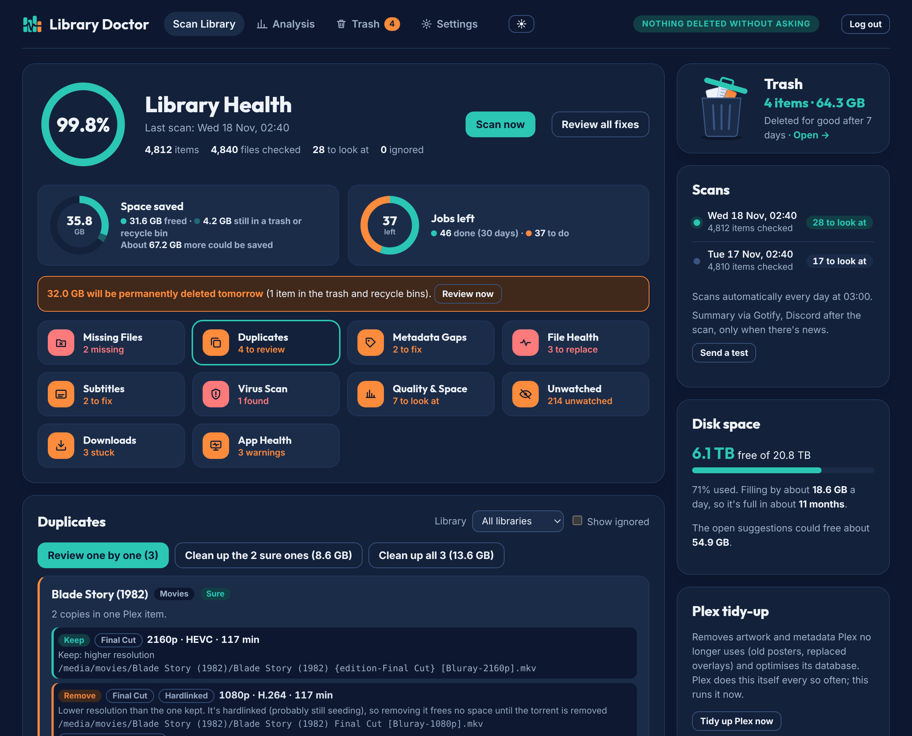
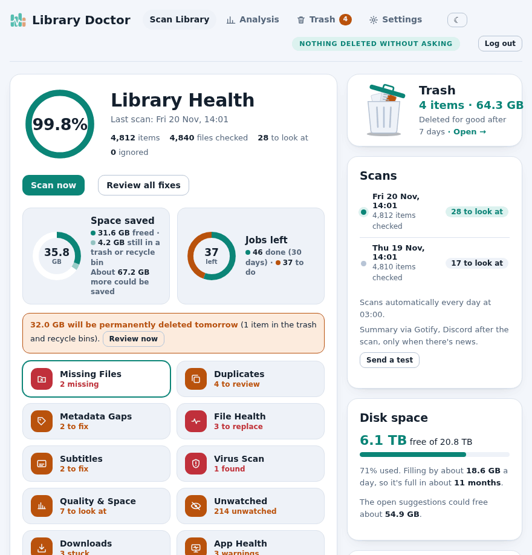

<p align="center"></p>

# Library Doctor

**A nightly health check for Plex, Radarr and Sonarr.** Library Doctor compares what Plex shows with what's really on the disk and what Radarr and Sonarr think they have. Every morning you get one page with everything that needs fixing, and a button to fix most of it.

> **New in 0.2: Jellyfin and Emby.** Pick your media server in Settings. Plex is the most tested; Jellyfin and Emby are new, so please report anything that looks wrong.

> **Beta.** Built on the author's own home server and now being tested on others. Please [open an issue](../../issues) if something looks wrong.

[Try the live demo](https://mymediabuild.uk/library-doctor-plex-library-health-check/#try-the-demo) (made-up library, nothing real is changed) · [How it works](https://mymediabuild.uk/library-doctor-plex-library-health-check/)

<p align="center">
  <picture>
    <source media="(prefers-color-scheme: light)" srcset="assets/screenshot-light.png">
    
  </picture>
</p>

<p align="center"></p>

## What it checks

| Check | What it finds | Needs |
|---|---|---|
| Missing files | Plex, Radarr or Sonarr list a file that isn't on the disk, and **season gaps**: aired episodes Sonarr wants but never got (Search for these) | Media server + Radarr/Sonarr |
| Duplicates | Two copies of the same film or episode, with which one to keep and why (different Plex editions, like Theatrical and Director's Cut, are never counted as duplicates, and neither are different films with the same title, like The Fly 1958 and 1986: if Plex mixed them up you get Split in Plex instead) | Plex |
| Metadata gaps | "Episode 5" titles Sonarr knows the name of, wrong years, things not in Radarr/Sonarr | Media server + Radarr/Sonarr |
| File health | Broken files, files much shorter than they should be, and **the wrong audio language** (also checked within 10 minutes of each import) (an English film with only Russian audio, a dubbed season). Replace asks Radarr/Sonarr for a new copy and checks it when it arrives | Media server + Radarr/Sonarr |
| Quality & space | Files far bigger than usual, old .ts/.avi files (Convert to MKV, no re-encoding), episodes much worse than their season, Find a smaller copy, and release groups whose files keep having to be replaced (Block it) | Media server + Radarr/Sonarr |
| Subtitles | Subtitle files that are only adverts, names that no longer match the video, what Bazarr is still looking for | Bazarr |
| Unwatched | What nobody has played in a year, biggest first (never deletes anything) | Tautulli |
| Virus scan | Programs pretending to be films (film.mkv.exe), and ClamAV on every new file | ClamAV (optional) |
| App Health | Each app's own warnings (Radarr/Sonarr/Prowlarr health, Bazarr, Tdarr nodes), apps that stop answering, updates (with Update now, or the Docker commands to copy), and indexers that keep failing and never find anything | Radarr/Sonarr (Prowlarr optional) |
| Downloads | Radarr/Sonarr queue problems: finished downloads they won't import (Import button), downloads that are stuck, with the reason from your download client (no seeds, tracker error, slow, usenet failure) and Re-announce / Remove & try another, and leftovers in the download clients' incomplete folder | Radarr/Sonarr (qBittorrent, Transmission, SABnzbd, NZBGet optional) |
| Disk space | Free space now and, after a week of daily readings, how fast it fills and roughly when it's full | — |

Tdarr (Convert with Tdarr) is optional too. For the nightly summary you can add any of Gotify, Discord, Telegram, ntfy, a webhook or email in Settings → Notifications.

## Nothing is deleted without asking

- Library Doctor **only reads** from your apps until you press a fix button.
- Every clean-up **moves** files into its own trash (`.library-doctor-trash` inside your media folder, same disk, so it's instant). You can put anything back for 7 days (3, 7, 14 or 30 in Settings), then the trash empties itself, but only after a closer look: a file is kept back if the copy that was kept is gone, a replacement hasn't arrived yet, or it would be the only copy.
- Suggestions are marked **Sure** (a tiny broken copy, a leftover temp file) or **Check** (two good copies, have a look first).

## Install (Docker Compose)

1. Make a folder, save [`compose.yaml`](compose.yaml) in it and change the three lines marked `CHANGE`:
   - `PUID` and `PGID`: the user and group that own your media (run `ls -ln /path/to/media`; the two numbers after the permissions)
   - `TZ` your time zone
   - `/path/to/media` the folder that holds your films and shows
2. Start it:
   ```sh
   docker compose up -d
   ```
3. Open `http://<your-server>:8790` and **create a password straight away**: until one is set, anyone who can reach the page could set it, so don't expose the port to the internet before this. Then add Plex and at least one Radarr or Sonarr under **Settings**. Press **Test** on each one, then **Save** and **Scan now**.

After that it scans by itself every night at 3am.

### Unraid

Library Doctor is in **Community Applications**: open **Apps**, search **Library Doctor** and click Install. Set **Media** to the share that holds your films and shows (e.g. `/mnt/user/data/media`); PUID 99 / PGID 100 are Unraid's defaults. Then open the WebUI and set a password.

If it doesn't show up yet (new apps appear after the next Community Applications update), use **Docker → Add Container → Template repositories**, add `https://github.com/spikey1965/unraid-templates`, and pick **library-doctor**.

### Synology (DSM 7.2, Container Manager)

Synology works, but two of its habits trip people up, so do these in order:

1. **Package Center:** install **Container Manager** (it creates a shared folder called `docker`).
2. **Give your user Read/Write on the shares.** Control Panel → Shared Folder → **docker** → Edit → **Permissions** → tick **Read/Write** for your own user. Do the same for the share with your films and shows (e.g. `media`). Being an administrator isn't enough: inside a container your user isn't in the administrators group, so without this Library Doctor can't write its own settings.
3. **File Station:** inside `docker`, make a folder `library-doctor`, and inside that a folder **`config`**. Synology's Docker doesn't create missing folders for you (otherwise it stops with *Bind mount failed: … does not exist*).
4. **Find your IDs:** your user is usually **1026** and the users group **100**. To be sure, enable SSH (Control Panel → Terminal & SNMP) and run `id`.
5. **Container Manager → Project → Create:** name `library-doctor`, path `/volume1/docker/library-doctor`, source **Create docker-compose.yml**, paste the compose file above with `PUID=1026`, `PGID=100` and your media share as `/volume1/media:/media`. Build, then open `http://your-nas:8790` and set a password.

Keep Library Doctor's port on your home network (don't forward it on your router).

### Mount your media as one folder

Library Doctor needs to see your films and shows inside **one** mount (for example `/mnt/media` with `movies/` and `tv/` inside it), mounted read-write. Clean-up moves files with a rename, which only works within one disk or dataset. If your films and shows are on different disks, mount their common parent folder.

### Folder mapping

Your apps may see the same files at different paths (Plex might say `/data/movies`, Radarr `/movies`, Library Doctor `/media/movies`). **Settings → Folder check** does this for every app at once: it asks each app for a few real files, applies that app's mapping and looks for them under `/media`, with ✓ or ✗ per app and a **Use suggested mapping** button when something's off. It runs by itself when you open Settings and after every save. You can also press **Detect folders** on one app's card, or add a mapping by hand.

Before every scan Library Doctor checks again: if it can't find Plex's or Radarr/Sonarr's files at all, the scan stops with a message instead of reporting your whole library as missing.

## Roadmap

No dates, just the order things are likely to happen. Ideas and offers to test are welcome in [Issues](https://github.com/spikey1965/library-doctor/issues).

- **Done in 0.2:** Jellyfin and Emby support (new: reports welcome).
- **Being considered:** music libraries; a Home Assistant card.

## Known limitations

This is a beta, so a few things are worth knowing before you start:

- **One media mount.** Clean-up, Replace and Convert to MKV move files into `.library-doctor-trash` with a rename, which only works within one disk or dataset. If your films and shows are on different disks, scans still work but those fixes can't move files; Library Doctor shows a warning on its main screen when it spots this.
- **Jellyfin and Emby are new (0.2).** Every check works on all three servers, but a few fixes only exist in Plex and are hidden on Jellyfin/Emby: Split (films Plex put together), Pick posters, Use Sonarr's titles, Fix Plex's listing, Plex tidy-up and the Plex database backup reminder. Jellyfin and Emby take a minute or two to notice moved files, so the check after a clean-up waits longer there. Emby needs its libraries' metadata downloaders on (the default when you add a library in Emby), or every item shows as not matched.
- **Tested on TrueNAS, a Debian server and Synology DSM 7.2** (Container Manager, in a test setup). Unraid, Raspberry Pi (ARM) and Docker Desktop haven't been tried by anyone yet. If you run one of those, or a real Synology, an issue saying how it went (good or bad) really helps.
- **Hardlinks.** A file that's also hardlinked elsewhere (typically a torrent that's still seeding) frees no space when it's moved. Library Doctor marks these as Hardlinked, never offers two links to the same file as duplicates, and doesn't count them in the space totals. Replacements made by Radarr itself (Find a smaller copy) can't be checked this way yet.
- **Sleeping disks.** The scan never reads your video files; it only checks they exist and their size (and reads small subtitle files). On a NAS whose disks spin down, that can still wake them, so pick fewer days under Settings → Automatic scan (once a week is fine).
- **Radarr/Sonarr v3 API.** It talks to the current Radarr and Sonarr (including Sonarr 5). Very old versions may not work.
- **English and the author's library.** The checks were tuned on one real library of about 7,500 films and episodes. If a check flags something that's actually fine, press Ignore and please open an issue.

## Behind a reverse proxy or SSO

Library Doctor has its own login. If Authentik, Authelia or your proxy already protects it, you can switch the built-in login off with `LD_AUTH=off`. Only do that when something else is in front: Library Doctor can move files.

Behind a reverse proxy, also set:

- `LD_TRUSTED_PROXIES` to your proxy's address or range (e.g. `172.16.0.0/12` for a proxy in Docker, `127.0.0.1` for one on the same host). Only then are `X-Forwarded-For` / `X-Forwarded-Proto` believed, so the login lock-out sees each visitor's real address. With `LD_AUTH=off`, Library Doctor then answers **only** those addresses; without it, only local network addresses.
- `LD_ALLOWED_HOSTS` to the name you open it by (e.g. `ld.example.com`). Requests for any other name are refused, which stops a web page from making your browser talk to Library Doctor (DNS rebinding). Strongly recommended with `LD_AUTH=off`. IP addresses and `localhost` always work.

Refused requests show a red warning on the main screen for a week.

## Settings (environment variables)

| Variable | Default | What it does |
|---|---|---|
| `TZ` | UTC | Time zone for the nightly scan |
| `LD_SCAN_HOUR` | `3` | Hour of the automatic scan until you set a time and days in Settings → Automatic scan (an out-of-range value like `99` turns it off) |
| `LD_TRASH_DAYS` | `7` | Days before the trash empties itself, until you pick 3, 7, 14 or 30 in Settings → Trash |
| `LD_KEEP_DAYS` | `182` | How long "Keep" hides an unwatched item |
| `LD_AUTH` | `on` | `off` = no built-in login (only behind another login) |
| `LD_TRUSTED_PROXIES` | (empty) | Your reverse proxy's address(es)/ranges, comma-separated. See Behind a reverse proxy |
| `LD_ALLOWED_HOSTS` | (empty) | The name(s) you open Library Doctor by, comma-separated; other names are refused |
| `LD_PORT` | `8790` | Port inside the container |
| `LD_CLAMD_HOST` / `LD_CLAMD_PORT` | `127.0.0.1` / `3310` | Your ClamAV (clamd), for the Virus Scan check |
| `LD_CLAM_ROOT` | `/scandir` | Where ClamAV sees the same media folder |
| `LD_SNOOZE_DAYS` | `30` | After "Search for better copies" finds nothing, hide the card this long, then search again |
| `LD_DOWNLOAD_WINDOW_END` | (unset) | If downloads only run at night, the hour the window ends (e.g. `7`); a torrent is "stuck" after a whole window at 0%. Unset = after 24 hours |
| `LD_QUEUE_NOTIFY_HOUR` | `8` | Hour the Downloads check sends new problems to your notifications (the window end, if set) |
| `LD_PROTECT_TAGS` | (empty) | qBittorrent tags never offered for removal, comma-separated (private torrents never are) |
| `LD_INCOMPLETE_DAYS` | `3` | Days an item in the incomplete folder must be untouched (and unknown to every download client) before it's offered for the trash |
| `LD_INCOMPLETE_DIRS` | (empty) | Extra incomplete folders to check, comma-separated, as Library Doctor sees them (the download clients' own folders are found by themselves) |

Everything else (apps, API keys, folder mapping) is set on the Settings page and saved in `/config/config.json`. API keys stay on your server and are never shown again after saving.

## Updating

```sh
docker compose pull && docker compose up -d
```

## Thank you

Library Doctor talks to Plex, Radarr, Sonarr, Bazarr, Tautulli, Tdarr, ClamAV, Gotify, Discord, Telegram and ntfy, and uses ffmpeg. It isn't connected to any of those projects.

The app logos in Settings come from [dashboard-icons](https://github.com/homarr-labs/dashboard-icons) (Apache-2.0). Each logo is a trademark of its owner.

Made by [My Media Build](https://mymediabuild.uk). MIT licence.
